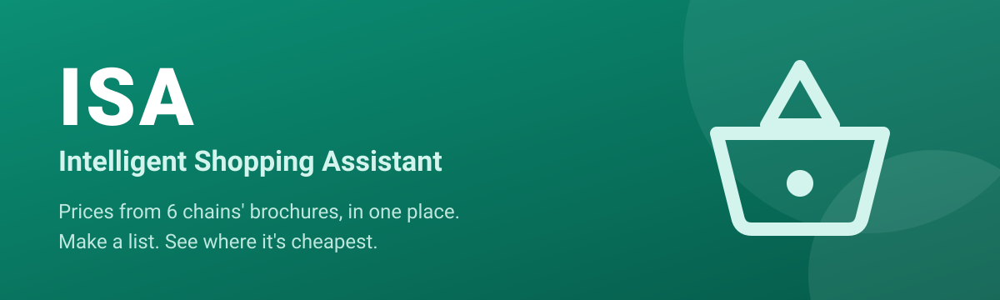
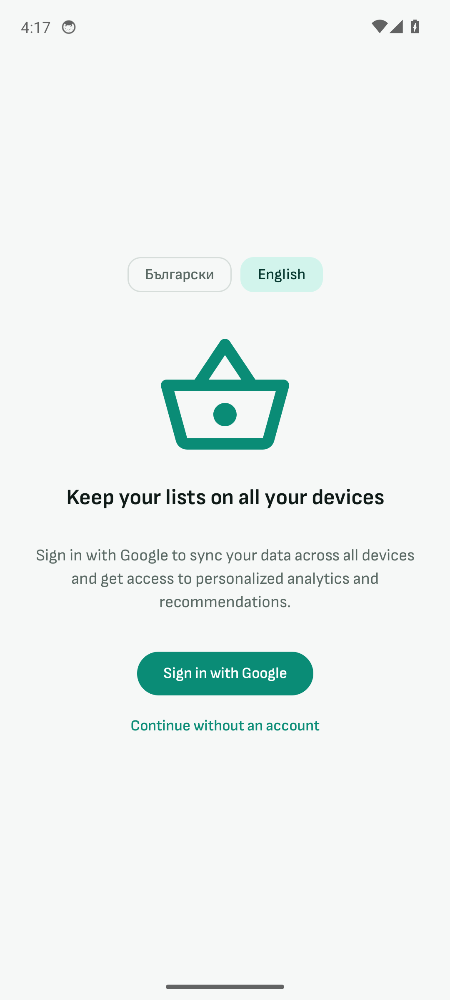
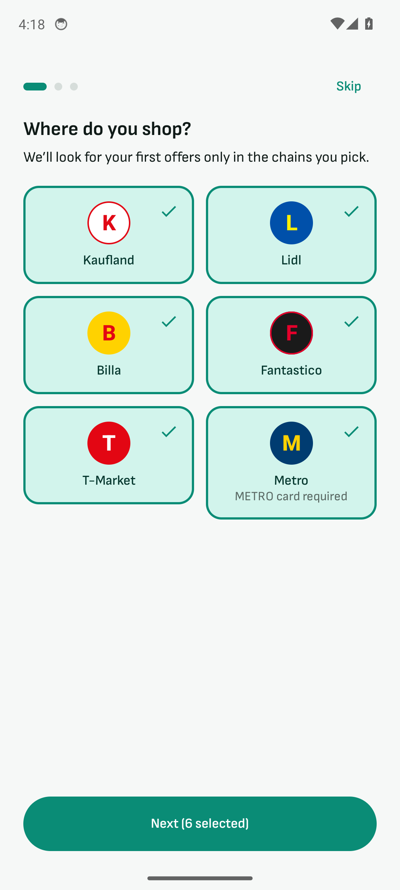
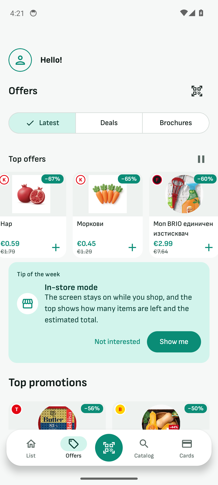
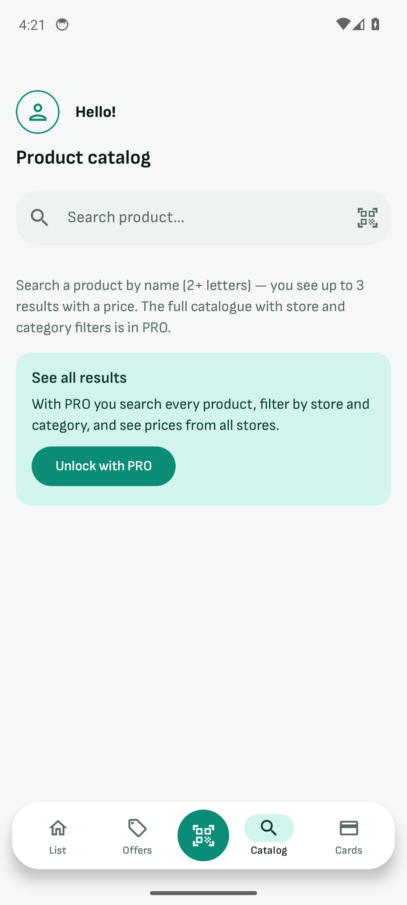

 

**An Android app that compares grocery prices across Bulgaria's biggest retail chains.**

> **Showcase repository.** This page presents the product and the engineering behind it. The source code is private.

---

## Screens

## What it does

| | |
|---|---|
| **Price comparison** | Prices from the brochures of six chains side by side, so you see where a basket is cheapest |
| **Shopping list** | Smart list with barcode scanning and a per-chain basket comparison |
| **Offers** | Latest offers, top deals and full brochures, refreshed automatically |
| **Receipts and savings** | Scan a receipt to tick off what you bought and track the discounts you caught |
| **Recipes, budget, loyalty cards** | Everything around the weekly shop in one place |
| **In-store mode** | Screen stays on, with items left and an estimated total at the top |
| **Sync** | Optional Google sign-in keeps your lists on all your devices |
| **PRO** | Subscription unlocks the full catalogue with store and category filters |

Bilingual (Bulgarian / English), prices in euro.

## Engineering

| Area | Approach |
|---|---|
| App | Kotlin, Jetpack Compose, Hilt, Room, DataStore, clean layering (UI, ViewModel, use case, repository) |
| Backend | Firebase: Firestore, Auth, Cloud Functions (TypeScript), Cloud Messaging, Storage, Hosting |
| Data pipeline | Scheduled Python pipeline that downloads brochures, extracts products with a vision model, normalises and matches them to a product catalogue, and computes price statistics and top promotions |
| Security | Firestore security rules with a dedicated rules test suite, secrets kept out of the repository |
| Monetisation | Google Play Billing subscription and AdMob |
| Privacy | Analytics are opt-in, with a clear explanation of exactly what is collected |

## Design language

<table>
<tr>
<td bgcolor="#0B8F75" width="130" align="center"><b>#0B8F75</b> teal</td>
<td bgcolor="#D2F4EC" width="130" align="center"><b>#D2F4EC</b> mint</td>
<td bgcolor="#F6F8F7" width="130" align="center"><b>#F6F8F7</b> paper</td>
<td bgcolor="#0F1A17" width="130" align="center"><b>#0F1A17</b> ink</td>
</tr>
</table>

A calm, friendly look: a single teal accent, generous spacing and large readable prices.

---

Built by [@ivaylozhivkov88](https://github.com/ivaylozhivkov88)

